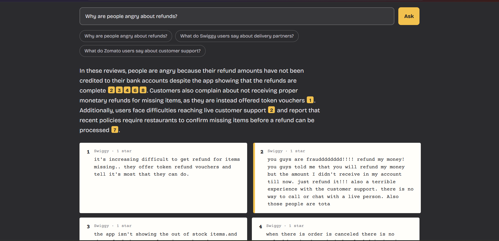
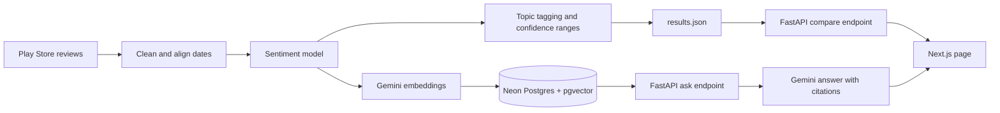

# Review Intelligence

Ask questions about what people say in public app reviews, and see how two apps compare. It analyses written Play Store reviews of two food delivery apps with a multilingual sentiment model, checks whether the gaps between them are real, and lets you ask free-form questions that are answered only from retrieved reviews, with the evidence shown.

**Live demo:** https://review-intelligence-phi.vercel.app
**API:** https://review-intelligence-api-u7qa.onrender.com/docs

> The API runs on a free host that sleeps when idle, so the first request can take up to a minute.




## What it does

1. **Compares two apps by topic.** Delivery, food quality, support, refunds and payments, pricing and offers, app bugs. Each receipt shows the share of negative written reviews per topic.
2. **Says whether a gap is real.** Every percentage gets a 95% confidence range. If two ranges overlap, the page says it can't tell the apps apart.
3. **Answers questions with evidence.** Type a question (English or Hinglish). The app retrieves the 8 most relevant reviews, and an LLM writes a short answer using only those, with citations you can hover to see the matching review.

## Data and results

- About 10,000 Play Store reviews per app, trimmed to the same dates (2026-10-26 to 2026-11-10): 15,656 reviews in the shared window.
- 3,803 of them are written reviews of five or more words (2,084 for one app, 1,719 for the other). Topic analysis uses only these. Star averages use all reviews.
- Sentiment model sanity check: reviews labelled negative average about 1.2 to 1.3 stars, positive about 3.6 to 3.9, and the model disagrees with the star rating on 11 to 13% of reviews (often sarcasm, or a review praising the other app).

What the sample shows (these describe this sample of reviews, not the companies):
- Swiggy's written reviews were more negative overall (60.8% vs 53.4% negative), and the confidence ranges don't overlap.
- Delivery shows the same direction (70.6% vs 63.2%), and the gap holds. On food quality, support, pricing and app bugs the ranges overlap, so there's no clear difference.
- Refunds and payments was the most negative topic for both apps (86.4% and 84.9%), and the two are essentially equal there.
- Most topic gaps are about the same size as the overall gap, so Swiggy's reviewers look more negative across the board, not especially on one topic.

## How it works



| Step | What happens | Where |
|---|---|---|
| Collect | `google-play-scraper` pulls recent public reviews | `scripts/collect_reviews.py` |
| Clean | Same date window for both apps, flag reviews of 5+ words | `scripts/clean.py` |
| Sentiment | `lxyuan/distilbert-base-multilingual-cased-sentiments-student` labels each written review | `scripts/sentiment.py` |
| Topics | Keyword lists assign reviews to six topics | `scripts/aspects.py` |
| Gaps | Wilson 95% confidence intervals per topic | `scripts/aspects.py` |
| Star scores | Bayesian-adjusted averages so small samples don't swing (computed, not yet shown in the UI) | `scripts/ranking.py` |
| Embeddings | `gemini-embedding-001`, 768 dimensions, stored in Postgres with pgvector | `scripts/embed_reviews.py`, `scripts/load_to_neon.py` |
| Ask | Cosine search for the top 8 reviews, then Gemini answers from them only | `backend/rag.py` |

## Tech stack

Python, pandas, Hugging Face Transformers, FastAPI, PostgreSQL with pgvector (Neon), Gemini API, Next.js, deployed on Render (API) and Vercel (frontend).

## Run it locally

```bash
git clone https://github.com/ayushiiiyadav/review-intelligence.git
cd review-intelligence
python -m venv venv
venv\Scripts\activate
pip install google-play-scraper pandas transformers torch google-genai python-dotenv "psycopg[binary]" fastapi uvicorn
```

Create a `.env` file in the project root:

```
GEMINI_API_KEY=your-key
GEMINI_MODEL=a-gemini-flash-model
GEMINI_FALLBACK_MODEL=optional-second-model
DATABASE_URL=your-postgres-connection-string
```

The raw review data is not in this repo. Build it yourself:

```bash
python scripts/collect_reviews.py
python scripts/clean.py
python scripts/sentiment.py
python scripts/aspects.py
python scripts/ranking.py
python scripts/export_results.py
python scripts/embed_reviews.py      # resumable; free-tier limit is about 1,000 requests a day
python scripts/load_to_neon.py       # needs a Postgres database with the pgvector extension
```

Run the API and the page in two terminals:

```bash
uvicorn backend.main:app --reload
```

```bash
cd frontend
npm install
npm run dev
```

Open http://localhost:3000. Set `NEXT_PUBLIC_API_URL` in the frontend if the API isn't on port 8000.

## Limitations

- **Small, short window.** About two weeks of recent reviews, so a single outage or promotion can shift the numbers.
- **Written reviews skew negative.** People write more when something went wrong, and reviews under five words were left out of the topic analysis. The topic percentages are not the apps' overall satisfaction.
- **Topics come from keyword lists.** A review that mentions two topics counts toward both, and some reviews will be misclassified.
- **Hinglish is a weak spot.** The sentiment model handles English and Hindi script better than romanised Hindi, so some reviews will be misread.
- **Ask covers 1,800 of the 3,803 written reviews.** I embedded the longest reviews first because of the free embedding limit, so answers lean toward detailed complaints.
- **LLM answers can slip.** The prompt requires citations and the page shows the retrieved reviews, but a citation can occasionally stretch what a review says. I haven't yet measured retrieval or answer quality on a test set.
- **Free hosting.** The API sleeps when idle and the AI model is sometimes briefly overloaded, so the page can show a "try again" message.

## Next steps

- Measure retrieval quality on a set of test questions.
- Discover topics by clustering embeddings instead of keyword lists.
- Compare any two apps, and track trends over time.

## Disclaimer

Results reflect a sample of public user reviews and not the actual performance of any company. This project is not affiliated with or endorsed by any company. Raw review text is not redistributed in this repository, and the Ask feature shows only short excerpts.
